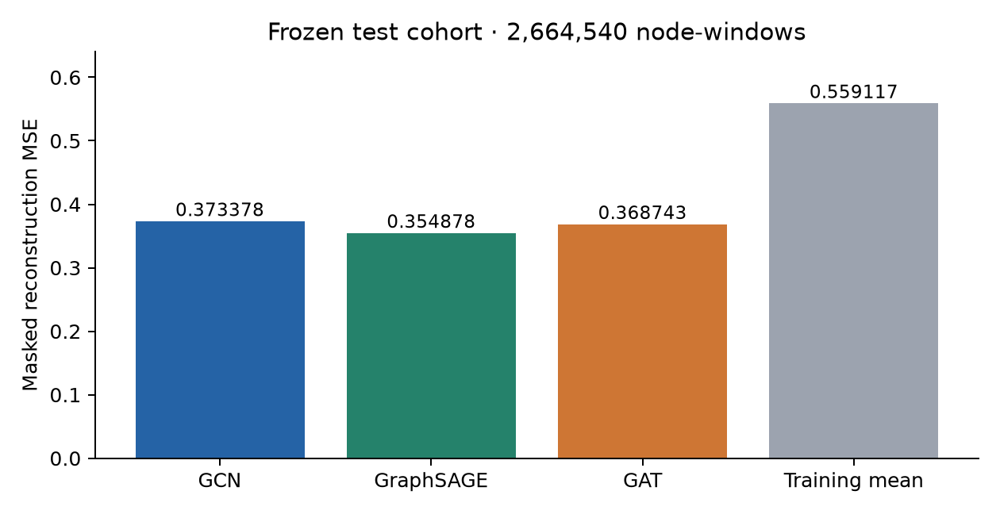
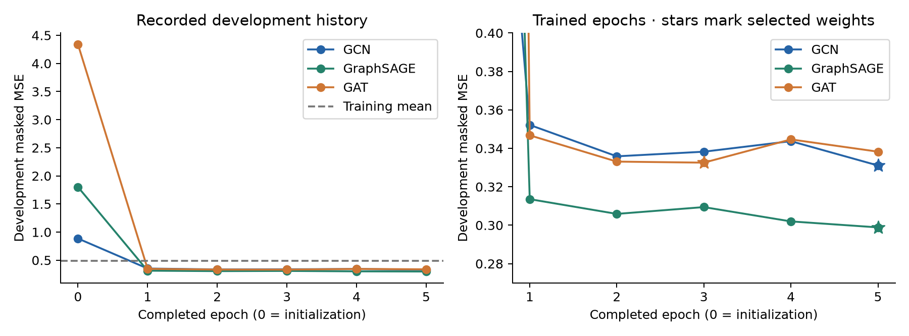
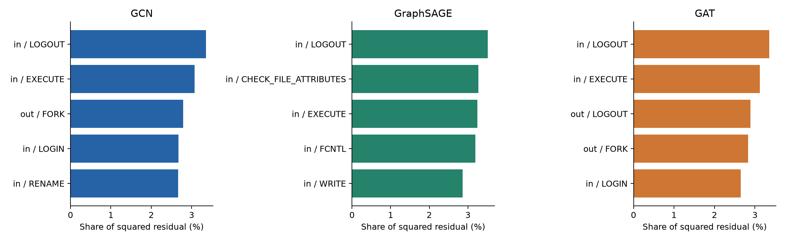

# Full local DARPA reconstruction results

Verified 2 November 2026. All three models completed five epochs and the same final test cohort.

| Model | Selected epoch | Parameters | Development MSE | Test MSE | Test MAE | Test MSE reduction vs mean |
|---|---:|---:|---:|---:|---:|---:|
| GCN | 5 | 13,299 | 0.331072538 | 0.373378216 | 0.086357332 | 33.22% |
| GraphSAGE | 5 | 22,707 | 0.298864339 | 0.354878308 | 0.066772435 | 36.53% |
| GAT | 3 | 13,491 | 0.332544491 | 0.368743389 | 0.071878950 | 34.05% |
| Training mean | — | 0 | 0.491797238 | 0.559116830 | Unrecorded | 0% |

GraphSAGE has the lowest development MSE and the lowest observed test MSE/MAE in this run.
These are normalized masked-feature reconstruction scores. No attack labels, detection accuracy, F1 or security threshold were evaluated.

The test set contains 2,664,540 node-window rows in 270 graphs. All 37 local archives were included in preparation;
the complete DARPA release is not claimed. Native entities recur across chronological partitions.
Five epochs and one seed per family do not establish optimality, uncertainty bounds, or independent incident generalization.

The ordinary and denoising autoencoder pilots use 62 features and different cohorts. Their MSE values do not form a matched comparison with these GNN results.
AE–1D-CNN–BiLSTM remains unimplemented/untrained in this experiment.

## Frozen test residuals

| Model | Median row MSE | 95th percentile | Maximum row MSE | Top 1% share of squared residual |
|---|---:|---:|---:|---:|
| GCN | 0.016183 | 0.870415 | 1726.447876 | 65.16% |
| GraphSAGE | 0.010364 | 0.990546 | 1682.260010 | 61.36% |
| GAT | 0.012120 | 0.763579 | 2705.290039 | 69.94% |

GraphSAGE has the lowest median row error, while GAT has the lowest 95th-percentile error.
GAT also has the largest maximum row error. The average-MSE ranking does not hold at every percentile.
Incoming LOGOUT counts contribute the largest single feature residual share for all three models.
Residual contribution measures numeric reconstruction error, not causal importance or malicious activity.

High reconstruction error is a review cue with unknown security intent. These descriptive test findings must not be used to tune the current models.

## Observed execution times

| Model | Training function minutes | Original final test seconds |
|---|---:|---:|
| GCN | 159.05 | 124.33 |
| GraphSAGE | 320.18 | 108.14 |
| GAT | 186.99 | 153.80 |

Training wall times include evaluation/checkpointing and different resource conditions. GCN and GraphSAGE used serial batch preparation;
GAT used CPU prefetching. These durations are not a controlled architecture-speed benchmark. All original final tests used prefetching.

See [the research report](../../../../../research/ml/gnn_results/README.md) for methods, validity limits and teammate commands.
