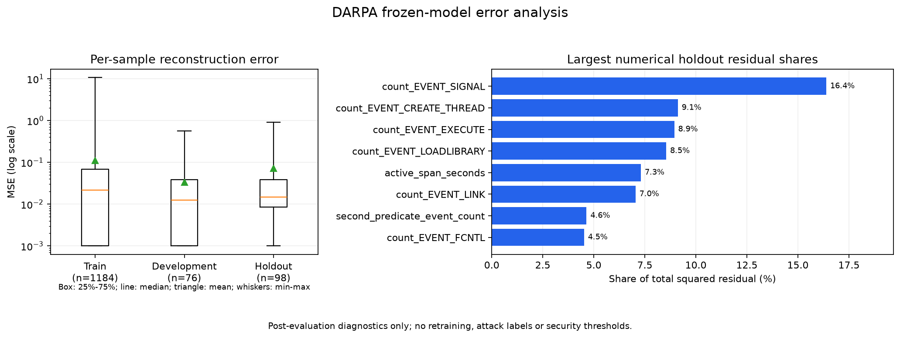

# Post-evaluation reconstruction diagnostics - 2026-10-29

**Completed with the epoch-185 model frozen.** The analysis reproduces the
existing aggregate errors, documents error concentration and feature residuals,
and prepares source-linked review entries. Model weights, settings, preprocessing
and security labels are unchanged. See the
[guide and commands](../../../../../research/ml/label_free/ERROR_ANALYSIS.md).

| Holdout statistic | Value |
|---|---:|
| Rows | 98 |
| Mean per-row MSE | 0.072373 |
| Median per-row MSE | 0.014623 |
| 90th / 95th percentile MSE | 0.103336 / 0.449588 |
| Maximum per-row MSE | 0.922778 |
| Error share of highest-error 5 / 10 rows | 57.43% / 74.58% |
| Rows with an exact raw profile seen in training | 34 |
| Mean MSE for those 34 rows | 0.005589 |
| Rows with a raw profile unseen in training | 64 |
| Mean MSE for those 64 rows | 0.107852 |
| Verified local review entries, across all partitions | 30 |
| Relevant software tests passed | 74 |



Largest holdout feature contributions to total squared residual:

| Feature | Residual share |
|---|---:|
| `count_EVENT_SIGNAL` | 16.39% |
| `count_EVENT_CREATE_THREAD` | 9.12% |
| `count_EVENT_EXECUTE` | 8.94% |
| `count_EVENT_LOADLIBRARY` | 8.55% |
| `active_span_seconds` | 7.31% |

The mean is dominated by a small tail, and exact numeric profile overlap is
associated with lower error in this cohort. Neither observation establishes
security intent or independent incident generalization. Residual decomposition
is not causal feature importance. CDM action names are native feature names,
not attack labels; decoder estimates are not additional observed Events.

All 30 highest-error review entries retain `security_label: null`. Their
native witnesses match publishing host, actor, window, first Event time,
archive/record position and original raw fingerprint in the saved Event index.
A witness establishes identity/source linkage, not all behavior or intent in
the aggregate window. Full traces and observed/reconstructed values remain local:

```text
C:\codes\PBL sem 7\tracegraph\.cache\ml-runs\label-free-error-analysis-20261029\review_queue.jsonl
```

The [full aggregate report](error_analysis_report_20261029.json) preserves all
62 feature residual summaries, distributions, tail shares, exact-profile
groups, reference comparisons and input fingerprints. No new raw archive was
read, no security threshold was chosen, and no optimizer was used. The frozen
checkpoint and all prepared partition fingerprints were rechecked afterward.

This is post-evaluation analysis of already inspected holdout data. Future
tuning requires a fresh suitable evaluation or explicit exploratory reporting.
Precision/recall/F1 and false-positive/false-negative security analysis remain
unsupported. LF-05 is complete; the original supervised/GNN tasks and production
integration retain their prior states.
