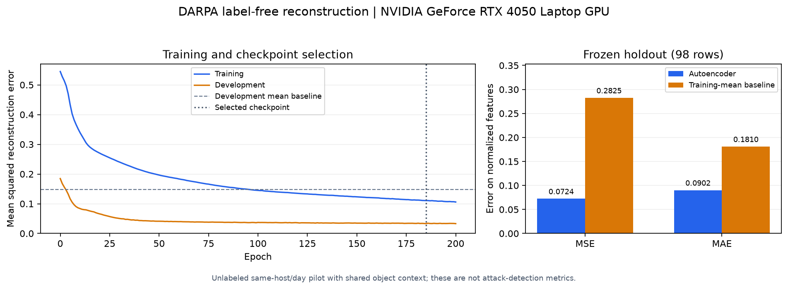

# GPU autoencoder training and final holdout - 2026-10-29

**Completed using the NVIDIA GeForce RTX 4050 Laptop GPU.** Both full runs
finished 200 epochs; development MSE selected epoch 185. The identical repeated
history/weights were verified before the primary checkpoint was evaluated on
98 reserved holdout rows. Full training and final reconstruction evaluation
are complete for the approved label-free route.

| Split | Samples | Autoencoder MSE | Mean baseline MSE | Autoencoder MAE | Mean baseline MAE |
|---|---:|---:|---:|---:|---:|
| Training, selected checkpoint | 1,184 | 0.110711 | 0.516129 | 0.100860 | 0.215315 |
| Development, selection only | 76 | 0.033141 | 0.147638 | 0.066415 | 0.164320 |
| Final holdout | 98 | 0.072373 | 0.282538 | 0.090200 | 0.181020 |

The holdout MSE is 74.38% lower than the training-mean reference on these
normalized vectors. That is a reconstruction-error reduction, not classification
accuracy or evidence that 74.38% of attacks are detected. Only one neural
architecture and one simple mean reference were compared.



## Run conditions and verification

- Fixed `62 -> 16 -> 4 -> 16 -> 62` autoencoder, 2,210 parameters; Adam with
  learning rate 0.001, weight decay 0.0001, batch size 64 and seed 42.
- 200-epoch maximum reached, 3,800 optimizer steps; no early-stopping trigger.
  Epoch 185 was selected strictly by the lowest development MSE, rather than
  the final training epoch or holdout performance.
- PyTorch 2.15.0+cu132, compiled CUDA 13.2, Python 3.11.9, driver 610.47.
  Actual model parameters and training tensors were on `cuda:0`.
- Float32 matmul `highest`, deterministic algorithms and cuBLAS workspace
  `:4096:8`; exact full-history and model-state equality across two fresh runs.
- Primary loop: 7.40 seconds including metrics/checkpoints; primary function:
  10.81 seconds including setup/transfers. Repeat: 8.93 / 12.32 seconds.
  These exclude dependency installation and Python import; a CPU speedup was
  not benchmarked.
- All **68 relevant software checks passed in the GPU environment**, with no
  skipped GPU test; dependency checks also pass. The CPU environment passes
  its 67 available checks and skips the GPU-only check.
- Checkpoint reload, code/config/data hashes, all prepared partition hashes,
  unchanged supervised annotations and unchanged post-evaluation weights were
  verified. No security label or threshold was created.

The [completion report](gpu_completion_report_20261029.json),
[training report](gpu_training_report_20261029.json),
[repeatability report](gpu_reproducibility_report_20261029.json), and
[final evaluation](gpu_holdout_report_20261029.json) contain exact values and
fingerprints. Selected model-state SHA-256:

```text
3f49dd2461293976045c1286340bebb776da38c83da1b0e63d829b0a4f658cc1
```

Local checkpoint:

```text
C:\codes\PBL sem 7\tracegraph\.cache\ml-runs\label-free-gpu-20261029\full-a\best.pt
```

Use the [GPU reproduction guide](../../../../../research/ml/label_free/GPU_TRAINING.md)
for environment setup and commands. Weights, feature data and environments remain
local; aggregate reports, code and this chart are in Git.

## Practical limits

Security labels remain unknown, training is not certified benign, and native
object context/numeric profiles remain shared across partitions. Later-actor
ownership filtering changes cohort composition; lower development error than
training error does not prove independent incident generalization. The data
covers one host/day and the final holdout contains 98 rows. No precision,
recall, F1, detection AUC or security threshold is supported.

LF-03 full training and LF-04 reconstruction holdout are complete. Original
supervised ML-02.4 remains blocked by evidence/groups, GNN work remains deferred,
and no production inference integration has been performed.
