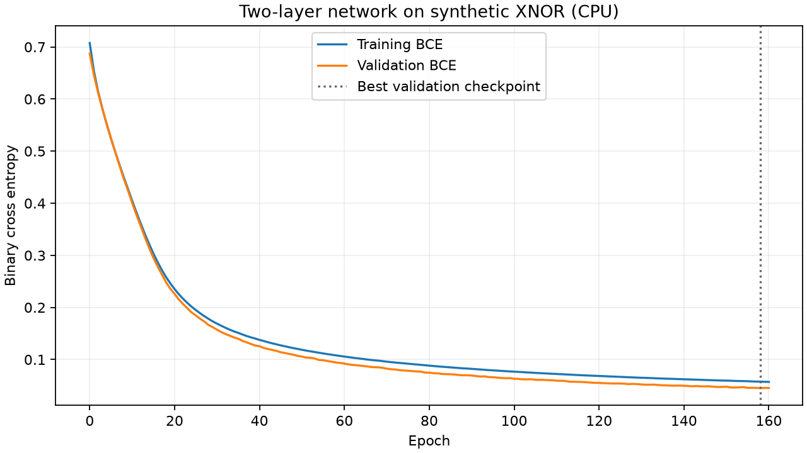
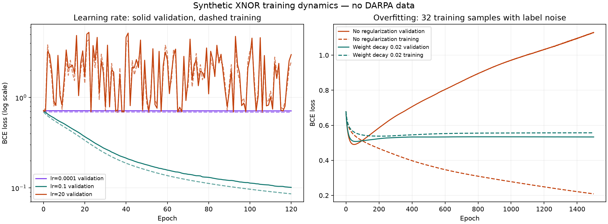

# ML-04 — neural-network fundamentals

Completed 2026-10-13 on CPU with Python 3.11.9, PyTorch 2.12.0+cpu,
NumPy 2.4.3 and Matplotlib 3.11.1. All data is generated synthetic XNOR:
`y = 1` when `x1 * x2 > 0`, otherwise `0`, with coordinates uniformly drawn
from `[-2, 2]`. These are educational experiments, not DARPA attack-detection
models. ML-02 real-data label/split blockers remain unchanged.
XNOR means equal sign bits receive label 1; it is the complement of XOR.

## Run from the repository root

Use a separate environment to keep these optional dependencies independent of
the data-preparation environment. No CUDA or downloaded dataset is required.

```powershell
python -m venv research/ml/.venv-nn
$NnPython = '.\research\ml\.venv-nn\Scripts\python.exe'
& $NnPython -m pip install torch==2.12.0 --index-url https://download.pytorch.org/whl/cpu
& $NnPython -m pip install -r research/ml/requirements-nn.txt
& $NnPython -m research.ml.nn_fundamentals.feedforward_demo `
  --output .cache/ml-runs/my-feedforward --seed 17 --epochs 160
& $NnPython -m research.ml.nn_fundamentals.training_dynamics `
  --output .cache/ml-runs/my-training-dynamics --seed 17
```

Linux/macOS: create the environment with `python3 -m venv research/ml/.venv-nn`
and replace `& $NnPython` with `research/ml/.venv-nn/bin/python`. Install the
same requirements; use the CPU package installation appropriate to your OS.
The existing local run used an already-installed Python environment, without
installing packages into the DARPA preparation environment.

Choose fresh output directories. Checkpoints and detailed epoch histories stay
in ignored `.cache/`. Each run saves `best.pt`, `results.json` and loss curves;
the dynamics run also saves a compact `summary.json` and five subdirectories.

## ML-04.1: tensor-to-training walkthrough

The demo uses 512 training and 256 independent validation examples. It fits
input mean and standard deviation on training only. Validation labels are clean.

1. A minibatch `X` has shape `[32, 2]`, labels `[32, 1]`, both float32 tensors.
2. `Linear(2, 16) -> ReLU -> Linear(16, 1)` produces `[32, 1]` raw logits.
   This is two parameterized layers and 65 trainable parameters.
3. `BCEWithLogitsLoss(logits, labels)` computes a scalar binary cross entropy.
   Sigmoid is inside the loss; applying sigmoid first would change its input
   contract. Apply sigmoid only to obtain inference probabilities.
4. `optimizer.zero_grad()` clears accumulated gradients, `loss.backward()`
   computes gradients, and SGD `optimizer.step()` updates weights.
5. Shuffle training minibatches each epoch; evaluate full training/validation
   loss after updates using `eval()` and `no_grad()`. Validation never updates
   parameters. Logged training BCE excludes the weight-decay penalty.
6. Save when validation BCE improves, and reload that checkpoint for inference.

The first update had gradient norm **0.181041** and parameter-change norm
**0.018104**, confirming an actual backward/update step. After 160 epochs the
best validation BCE was **0.045088**, at epoch 158.



## ML-04.2: controlled training dynamics

The learning-rate comparison holds data (320 training/256 validation), seed,
initial weights, hidden width 16, batch size 32 and 120 epochs fixed. Only the
learning rate changes. The overfitting comparison holds the same 32 training
and 256 validation samples, seed, initial weights, width 128, learning rate 0.2
and 1,500 epochs fixed; only weight decay changes. Nine training labels are
flipped using a seeded 30% noise probability, while validation remains clean.

| Experiment | Best epoch | Best validation BCE | Final training BCE | Final validation BCE |
|---|---:|---:|---:|---:|
| Low learning rate 0.0001 | 120 | 0.711368 | 0.688028 | 0.711368 |
| Appropriate learning rate 0.1 | 120 | 0.101427 | 0.085985 | 0.101427 |
| High learning rate 20 | 65 | 0.692520 | 2.479416 | 2.986322 |
| Small/noisy set, no regularization | 49 | 0.490548 | 0.208856 | 1.129252 |
| Same small/noisy set, weight decay 0.02 | 59 | 0.507587 | 0.557083 | 0.533440 |

The low learning rate barely changes the loss. The high rate oscillates and
ends worse than its initial validation BCE. With small/noisy data, declining
training BCE alongside rising validation BCE demonstrates overfitting. Weight
decay reduces the late generalization gap but has a slightly worse best
validation BCE than the unregularized run. Regularization and selecting an
early checkpoint are distinct choices; this single seed does not establish
that weight decay is universally better.



## Checkpoint validation and reuse

All six experiments saved and reloaded their best checkpoints. Reloaded
validation logits matched the captured best-model logits exactly: maximum
absolute difference **0.0**. Checkpoints contain model weights, hidden width,
best epoch/loss and training-only scaling tensors. The model is serialized
immediately on improvement rather than keeping a mutable `state_dict` alias.
Loading uses `weights_only=True` and inference uses `eval()`/`no_grad()`.

Standalone inference applies the saved scaler to raw inputs:

```python
from research.ml.nn_fundamentals.feedforward_demo import predict_from_checkpoint

probabilities = predict_from_checkpoint(
    '.cache/ml-runs/my-feedforward/best.pt',
    [[1.0, 1.0], [-1.0, 1.0], [-1.0, -1.0], [1.0, -1.0]],
)
print(probabilities)
```

The expected toy labels are `[1, 0, 1, 0]`. Seed 17, CPU execution, one torch
thread and deterministic algorithms make randomness explicit. Bit-for-bit
agreement across different PyTorch versions/platforms is not promised.
The scripts stop and record non-finite losses/gradients rather than silently
continuing invalid training. No such stop occurred in the recorded experiments.

The committed [summary](results/run_summary.json) records measured results and
configuration; checkpoints and detailed histories remain local. No held-out
security test set, detection metric or production integration is claimed.

References: [PyTorch BCEWithLogitsLoss](https://docs.pytorch.org/docs/stable/generated/torch.nn.BCEWithLogitsLoss.html)
for the loss input contract; [saving/loading models](https://docs.pytorch.org/tutorials/beginner/saving_loading_models.html)
for state dictionaries and inference checkpoint reuse.
